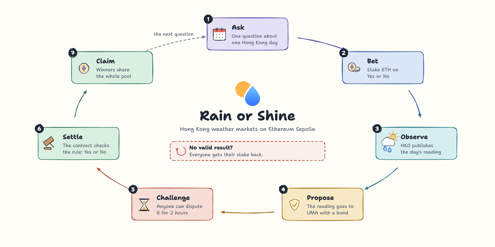
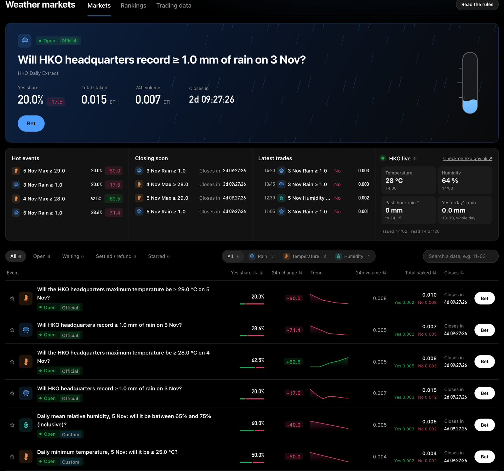

# Rain or Shine

Rain or Shine is a prediction market for Hong Kong weather. It runs on the Ethereum Sepolia testnet. Each market asks
one question about a reading, for example "Will HKO headquarters record ≥ 1.0 mm of rain on 3 Nov?". People take Yes
or No with test ETH. The Hong Kong Observatory publishes the reading. UMA's Optimistic Oracle V3 confirms it. Winners
share all the stakes. There is no platform fee. The interface is in Chinese and English.

- Project page: https://leon1111-wgl.github.io/rain-or-shine/
- Live app on Sepolia: https://leon1111-wgl.github.io/rain-or-shine/app/
- Downloads for macOS and Windows: https://github.com/leon1111-wgl/rain-or-shine/releases
- Security: [SECURITY.md](SECURITY.md)





## How a market works

1. The administrator creates a market. Its question, threshold, day, proposer and deadlines are fixed in its rules.
2. While betting is open, a wallet picks Yes or No. After that it can only add to the same side. Bets cannot be
   withdrawn.
3. After HKO publishes the day's data, the proposer submits the reading to UMA with a bond. The proposer cannot bet
   in that market.
4. Anyone can dispute during the challenge period. After it, anyone can settle. The contract then decides Yes or No.
5. Everyone is refunded if only one side has stakes at the close. The same happens if the oracle rejects the result.
   It also happens if no undisputed result arrives by the refund deadline.

Official markets read daily rainfall and daily maximum temperature at HKO headquarters. Custom markets read another
weather value. That can be any numeric column of the HKO Daily Extract, or another public source. On the local chain,
two sports demos show that a market can follow any number. Their results are labelled synthetic files.

## What you need

- Node.js 24 (`.nvmrc` pins 24.21.0) and npm.
- A browser with MetaMask.
- Free ports 8545 (local chain) and 5173 (the app).
- No `.env` file and no private key, unless you deploy your own copy.

```sh
npm ci
```

## Use it on Sepolia

```sh
npm run dev:metric:sepolia
```

The app opens at http://localhost:5173 and reads the Sepolia deployment. It reads the chain through public RPCs, so
it needs no key. To act, use MetaMask on Sepolia (chain ID 11155111). Turn on "Show test networks" if MetaMask hides
it. Get a little Sepolia ETH from a faucet, such as https://sepolia-faucet.pk910.de.

Who can do what:

- Anyone can bet, settle a result after its challenge period, and claim winnings or refunds.
- Only the administrator in `deployments/metric.sepolia.json` can create markets.
- Only a market's proposer can submit its result. Proposing or disputing needs the 6TEST bond token. Anyone can mint
  it on its contract page: https://sepolia.etherscan.io/address/0x3870419Ba2BBf0127060bCB37f69A1b1C090992B#writeContract
  (`mint`, `to` = your address, `amount` = `100000000` for 100 6TEST).

## Try the full cycle on a local chain

The local chain uses a labelled simulated oracle instead of UMA. It also lets you move time forward.

```sh
npm run node:local
```

Keep that terminal open. In a second terminal:

```sh
npm run deploy:metric:local
```

```sh
npm run seed:metric:local
```

```sh
npm run dev:metric
```

The seed is optional. It adds metrics, markets #1 to #10 and two days of bets. #8 and #9 are the sports demos. #8 is
settled. #9 is open. Its result file is `fixtures/demo/sports/football-ars-che.json`.

In MetaMask, add a network with RPC URL `http://127.0.0.1:8545`, chain ID `31337` and currency `ETH`. The first
terminal printed 20 test accounts with their keys. Import four of them: #0 to #3. Account #0 is the administrator.
Account #1 will submit the result. Accounts #2 and #3 will bet. These keys are public and only for chain 31337. Never
use them anywhere else.

Then, in the app:

1. As account #0, open Operations. In "New market", pick the "AFTERNOON TEMPERATURE" card from the seed, or define a
   new metric. Fill in the source name, its link and the reading procedure.
2. Set "Observation window" to "A start and end of my choice", with a window that starts soon. Under "Advanced
   timing", set the proposer to account #1. Check the preview and click "Create prediction market".
3. In "Local time controls", click "Advance to betting open".
4. As account #2, open the market from the link under the form. Bet 0.01 ETH on Yes. As account #3, bet 0.01 ETH on
   No.
5. As account #1, open Operations and click "Advance to result submission". Under "Submit observed result", paste a
   short report and type the reading. Click "Check result". Click "Get 100 tBOND", then "1. Approve adapter bond" and
   "2. Submit result".
6. Click "Advance past dispute deadline", then "Settle assertion". Any account can settle.
7. As the winning account, open the market's "Settlement & refund" view and click "Claim winnings".

A preset that is not registered yet, such as "Daily mean pressure", takes two wallet confirmations. The first
registers the metric. The second creates the market.

## Checks

Run these before a commit. The E2E suite starts its own local chain and app, and it needs Google Chrome.

```sh
npm run lint
npm run typecheck
npm run test:contracts
npm run test:shared
npm run test:web
npm run check:architecture
npm run build:metric:sepolia
npm run test:e2e
```

## Desktop package

```sh
npm run package:desktop
```

This builds three zips in `release/`: macOS for Apple silicon, macOS for Intel, and Windows x64. Ready-made copies
are on the Releases page. The Desktop check workflow builds the zips and starts them on Windows and macOS. Each zip holds the
built Sepolia app, a small local server and a Node runtime. The other computer installs nothing. Unzip one and open
`READ_FIRST.html`.

## GitHub Pages

`.github/workflows/pages.yml` publishes on every push to `main`. The project page in `site/` goes to the site root. The
Sepolia app goes to `/app/`. Turn it on once in Settings > Pages > Source: GitHub Actions. The app reads the chain
through public RPCs. The live weather panel reads HKO directly. The Daily Extract file does not allow that, so on Pages
a proposer imports it as a file.

## HKO evidence tool

```sh
npm run weather:collect -- --date 20261103 --metric both
```

It saves the day's readings and HKO's monthly file in `weather-results/`. A proposer imports them in the result
panel. When the page runs on its own server, the panel can also fetch the file itself.

## Deploy your own copy to Sepolia

Your copy has your own administrator. Nothing here reads a key from a file in the repository.

1. Store your deployer key in Hardhat's encrypted keystore: `npx hardhat keystore set SEPOLIA_DEPLOYER_KEY`.
2. In your terminal, set `SEPOLIA_RPC_URL` to any Sepolia RPC. Set `SEPOLIA_CHECK_ADDRESS` to the deployer's public
   address. `env.example` lists every variable.
3. Move `deployments/metric.sepolia.json` to another folder. The deploy script will not overwrite it.
4. Run `npm run preflight:metric:sepolia`, then `DEPLOY_CONFIRM=sepolia npm run deploy:metric:sepolia`. It writes
   your addresses to `deployments/metric.sepolia.json`.
5. Connect the administrator wallet and create markets in Operations.

## Where things are

- `contracts/PredictionMarket.sol`: markets, bets, results, refunds and claims.
- `contracts/UmaMetricOracleAdapter.sol`: the only contract that talks to UMA.
- `contracts/MetricRegistry.sol` and `contracts/ConditionLib.sol`: the metrics, and how a reading meets a condition.
- `deployments/metric.sepolia.json`: the Sepolia addresses the app uses.
- `web/`: the React app. `src/`: shared rules, payout and weather code. `scripts/`: deployment, seeding and evidence
  tools.
- `site/`: the project page. `docs/DEMO_SCRIPT.md`: the script for the demo video.
